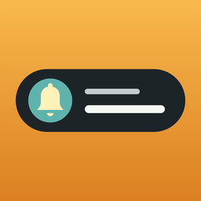
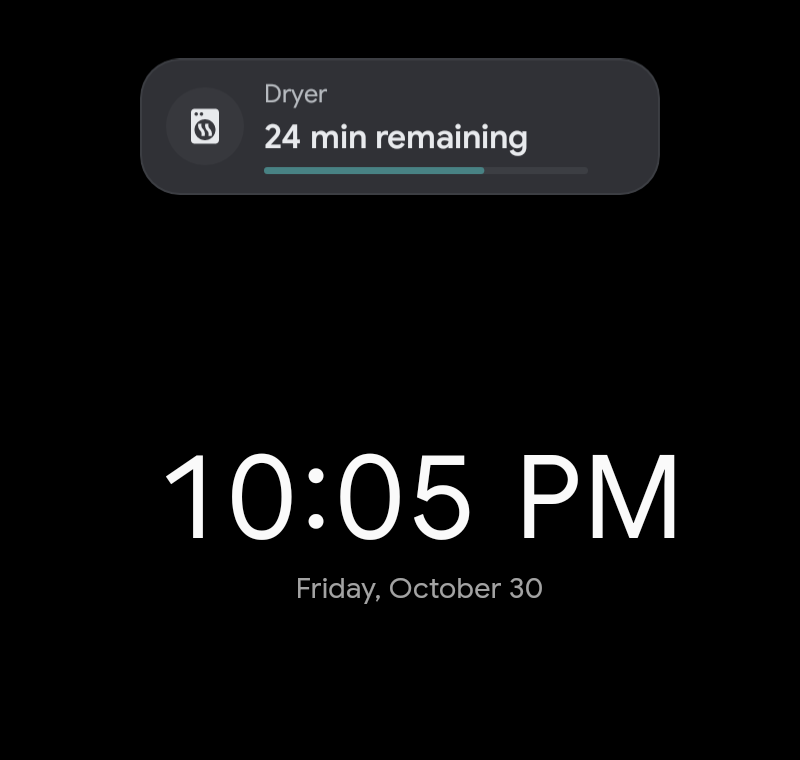
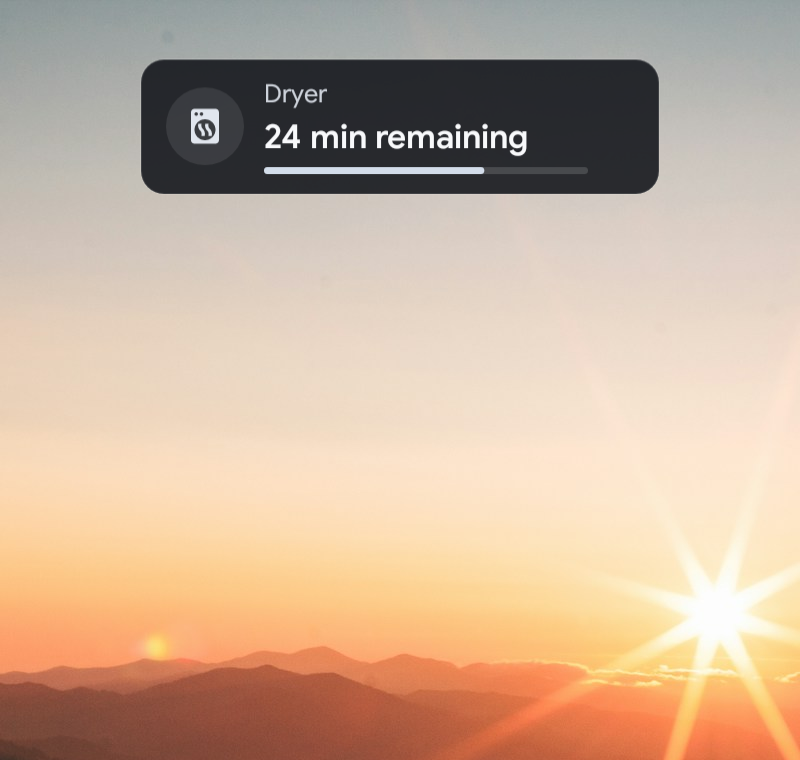

# Live notifications for Kiosk Satellite

**A rotating live-status bar for your [Kiosk Satellite](https://github.com/jxlarrea/kiosk-satellite) wall display.**
See the laundry's time remaining, a vacuum's progress or a vehicle's arrival time,
one notification at a time. It sits over your dashboard or existing screensaver,
without replacing the clock or getting in the way of a touch.

<p align="center">
  
  
</p>

**Native** follows KS's theme. **Glass** is a translucent dark surface for photos.

## Why use it

- **One thing at a time.** Relevant notifications rotate in your chosen order,
  with time to read each one. A single notification stays still.
- **Start with one entity.** Its name, icon and state fill themselves in.
  Separate sources for text, icons, visibility and progress are optional.
- **Only when it matters.** Show an appliance while it's running, or a sensor
  above a threshold. Missing or unavailable data doesn't become a stale notice.
- **Dashboard, screensaver, or both.** Choose **Always**, **Screensaver only**
  or **Dashboard only**, without changing your screensaver.
- **Fits KS.** Native colors, icons and type, with an optional Glass style.
  A gentle roller changes the content inside a stationary chip; motion can be off.
- **Read-only.** No buttons, service calls, tap actions or touch interception.
  Nothing to dismiss and no notification history.

## Installation

Requires Kiosk Satellite **2026.10.42+**, Android **8.0+**, and a KS connection
to Home Assistant for live values.

[](https://kiosksatellite.com/redirect/plugin/?repository=dimatx/kiosk-satellite-live-notifications)

You can also open **Plugin Manager > Add plugin** and paste:

```text
https://github.com/dimatx/kiosk-satellite-live-notifications
```

Review the preview, confirm that you trust the plugin, install it, and enable
**Live notifications**. Repository installation includes update checks for new
stable versions.

### First steps

1. Open **Live notifications** and choose **Add notification**.
2. Pick a **Primary entity**. Leave **Use different sources** off to use its
   name, icon and state, then choose when it should show.
3. Under **User interface**, choose **Show on** and **Style**.
4. Under **Placement**, turn on **Preview sample notifications** to position the
   chip. It uses clearly labeled sample data, even when your real conditions don't match.
5. Turn preview off. Your eligible notifications now appear in the chosen scope.

Settings are available on the kiosk and in Remote Admin, and take effect as you
save them. Preview also stops when settings close, the screen turns off, or two
minutes pass.

## Notifications

A notification starts with one entity. **Show when** can check availability, an
exact state, or a numeric comparison. For example, use the dryer's running state
to decide when to show it, and its remaining-time sensor for the text.

**Progress bar > Automatic** recognizes a displayed percentage. Choose **On**
to use a separate completion sensor, reporting 0–100; choose **Off** to hide it.
Time remaining is not treated as progress. The optional **Live indicator** is
off by default.

See the [source and progress examples](docs/reference.md#practical-source-examples)
for dryers, vacuums and vehicle arrival, including how to use entity attributes.

## Settings

| Group | What it controls |
| --- | --- |
| User interface | Global enable, where to show, Native/Glass style and text/icon size |
| Notifications | What each row says, when to show it and optional progress |
| Screensaver | **Style on screensaver**: Default, Native or Glass |
| Rotation | Reading time and motion |
| Placement | Position, offsets, width and sample preview |

**Style on screensaver > Default** follows the general **Style**, not the stock
clock's settings. Position, size and rotation stay shared.

Placement is manual: use preview to leave room for clocks, widgets and bars.
There is **no automatic collision avoidance**. Adaptive width fits portrait and
landscape; long text stays on one line with an ellipsis.

Up to 32 rows can be configured, using **16 unique HA entities** across their
sources. Reused entities count once. See the [full reference](docs/reference.md)
for every setting, limits and upgrade behavior.

## Privacy

Live notifications reads only the entities you choose, through Kiosk Satellite's
own Home Assistant connection. It never sees a Home Assistant token, calls a
service, or sends data anywhere else. Its permissions are `overlay` and `host.read`.

## Related plugins

[Navbar](https://github.com/dimatx/kiosk-satellite-navbar) moves between dashboards,
menus and camera views. [Action Bar](https://github.com/dimatx/kiosk-satellite-action-bar)
adds controls for lights, covers, locks and other entities. Both are optional;
Live notifications works on its own.

## Credits

Built with the [Kiosk Satellite plugin SDK](https://github.com/jxlarrea/kiosk-satellite-plugins)
by [@jxlarrea](https://github.com/jxlarrea). Conceptually inspired by
[ks-live-activities](https://github.com/jtscott/ks-live-activities).

## License

[Apache-2.0](LICENSE). See [NOTICE](NOTICE) for SDK/tooling attribution and
[screenshot credits](docs/screenshots/README.md) for the documentation images.

[Development guide](CONTRIBUTING.md) · [Changelog](CHANGELOG.md)
